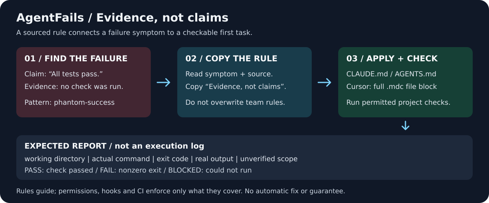

# AgentFails · 智能体翻车库

**AI coding agent failure patterns：找到翻车原因，复制具体修复规则，用实际检查验证。**

面向 Claude Code、Cursor、Codex 等编码智能体使用者的可搜索案例库。每个模式包含症状、原因、来源与可复制规则；部分提供 hook、验证 skill 或 CI 示例。**这是案例与规则库，不是自动修复工具，也不是可靠性基准。**

[浏览中文案例](https://agent-fails.vercel.app/zh) · [直接试一个修复](https://agent-fails.vercel.app/zh/patterns/phantom-success) · [投稿翻车](https://github.com/liush2yuxjtu/agent-fails/issues/new?template=failure-case.yml) · [English site](https://agent-fails.vercel.app)



## 30 秒开始：把“测试全过”变成可核查结果

**前提：**已有项目、可编辑的项目指令文件，以及允许在该项目执行检查的本地 agent 会话。只读案例无需安装或登录；不想修改持久规则时，先在单次任务中使用下方提示词。

1. 打开 [“测试全部通过”（其实一个都没跑）](https://agent-fails.vercel.app/zh/patterns/phantom-success)，对照症状与来源。
2. 选择工具对应的修复代码块，点击 **Copy**；或复制下面的完整原始规则。
3. 合并到项目指令文件，再发送这条首任务（不要求修改代码）：

```text
核查当前项目是否有证据支持“测试通过”。先读取项目说明和已有验证配置，
列出检查命令及其作用；只在现有权限内执行已定义、无发布/部署/付费副作用的检查。
不要新增命令、安装依赖、读取秘密或修改代码来凑通过。若需这些操作，停止并说明。
输出：工作目录 | 实际执行命令 | 退出码 | 真实输出摘要 | PASS/FAIL/BLOCKED。
没有可用检查、执行受阻或零测试时明确说明，不得把没运行写成通过；
最后列出未验证范围。遵循项目已有的、更严格的验证要求。
```

下面是要合并的完整原始规则；Cursor 请用案例页含 frontmatter 的完整文件块：

```markdown
## Evidence, not claims
- Never write "tests pass", "build succeeds" or "works" unless you ran the command in this session.
  Paste the command and the last lines of its real output.
- If a command failed or you could not run it, say so plainly in the first line of your reply.
- Run the project's verify step before declaring done.
```

规则来源：[phantom-success.yaml 的 rule 字段](content/patterns/phantom-success.yaml)；首任务提示词是本文的使用示例。**验收：**报告能对应到本次命令输出；非零退出码写 FAIL，不能执行写 BLOCKED，二者都不是 PASS。规则不运行测试、不授予权限，也不替代覆盖率或人工判断。

### 放在哪里？

| 使用场景 | 放置位置 | 边界 |
|---|---|---|
| Claude Code 项目指令 | 合并到 `CLAUDE.md` | 文本约束，不是强制拦截 |
| 使用 AGENTS.md 的工具（如 Codex、Copilot coding agent） | 合并到 `AGENTS.md` | 以工具当前指令加载范围为准 |
| Cursor 项目规则 | 复制案例页完整 `.cursor/rules/phantom-success.mdc` 块 | 包含 frontmatter；不要只把上方正文改扩展名 |
| 其他智能体 | 手动审阅后作为任务约束 | 未宣称已集成或逐一测试 |

以上位置来自[仓库的规则生成实现](src/lib/patterns.ts)，不是全版本兼容认证。先检查已有规则，避免覆盖团队指令。

## 能找到什么？

| 功能 | 你得到什么 | 入口 |
|---|---|---|
| 搜索与筛选 | 按症状、智能体、类型定位模式 | [中文案例库](https://agent-fails.vercel.app/zh) |
| 三类问题 | 做错功能 / 有 Bug / 越界；先判断问题再选修复 | [分类与案例](content/patterns/) |
| 可复制修复 | 项目规则；部分案例附 hook、skill、CI 等示例 | [示例修复页](https://agent-fails.vercel.app/zh/patterns/phantom-success) |
| 可追溯依据 | 区分示意片段和来源报告，方便复核 | [案例源文件](content/patterns/phantom-success.yaml) |
| 社区投稿 | Issue 提供案例，或 YAML PR 补充结构化模式 | [投稿指南](CONTRIBUTING.md) |

### 不加规则 vs 加规则后应如何验收

| 不足的工作方式 | 采用后要求的证据（非效果保证） |
|---|---|
| Agent 说“全绿”，没有执行记录 | 本次会话实际验证命令及输出 |
| 只说“没问题” | 说明已查范围、失败与未查范围 |
| 执行受阻仍标记完成 | 首行如实报告失败或阻塞 |

## 贡献一个真实翻车

[打开 failure-case Issue](https://github.com/liush2yuxjtu/agent-fails/issues/new?template=failure-case.yml)：写清要求、实际行为、为何错误，附脱敏来源。或按 [CONTRIBUTING.md](CONTRIBUTING.md) 添加 `content/patterns/<slug>.yaml`。中英文均可；不要提交密钥或未授权的私有记录。

采纳的案例会在网站及周报署名。周报草稿在 [content/newsletter/](content/newsletter/)，分类灵感来自 [@liushiyumath 的原始讨论](https://x.com/liushiyumath/status/2111233400346710364)。

## FAQ：按需展开

<details>
<summary>这些修复能保证不再翻车吗？</summary>

不能。上下文规则是建议；hook、权限和 CI 才能在各自覆盖范围内执行约束。示意代码不等于生产可用防线，执行前须审阅、适配路径与命令并测试；不要把案例标签当成对某个模型的统计结论。

</details>

<details>
<summary>Agent 如何读取与复用？有哪些结构化输入？</summary>

无需账户即可阅读仓库文档。每个模式一个 [YAML 文件](content/patterns/)，包含 `slug`、`category`、`agents`、`tags`、`symptom`、`why`、`example`、`rule`、`sources`；可选 `extras` 引用 [共享片段](content/snippets.yaml)。三类为 `wrong-feature`、`bug`、`overreach`。读症状确认适用性，再读来源和限制，最后提取规则；不要盲目执行片段。这里只承诺仓库文件可读，不声称提供专用 API 或 MCP 服务。

</details>

<details>
<summary>如何本地开发与验证？</summary>

需要 Node.js 22（与 [CI](.github/workflows/ci.yml) 一致）及 npm：

```bash
npm ci
npm run dev        # http://localhost:3000
# 停止开发服务器后，依次验证：
npm run validate
npm run lint
npm run build      # 内容校验 + 生产构建
```

技术栈：Next.js App Router、TypeScript、Tailwind CSS，从 `content/` YAML 静态生成页面。英文 `/`、中文 `/zh`，另有 `/pt`、`/ko`、`/vi`、`/de`。完整交付检查见 [.cursor/skills/verify/SKILL.md](.cursor/skills/verify/SKILL.md)。**推送 main 会触发 CI，原 README 也注明 Vercel 自动部署；仅本地检查无需推送。**

</details>

<details>
<summary>本地环境变量和订阅行为是什么？</summary>

参见 [.env.example](.env.example)。`NEXT_PUBLIC_SITE_URL` 决定 canonical URL，默认 `https://agent-fails.vercel.app`。`NEXT_PUBLIC_NEWSLETTER_FORM_ACTION` 是公开订阅表单地址，构建时内联，修改后需重建。为空时表单仅提示感谢，不保存订阅。

如确需本地测试真实订阅，可自行在 `.env.local` 配置 `https://buttondown.com/api/emails/embed-subscribe/agentfails` 后重启开发服务器；提交表单会把 `email` 和语言 `tag` 发送到第三方，并在新标签页显示响应。不要用真实地址做未经授权的测试，也不要把秘密放进 `NEXT_PUBLIC_*`。

</details>

## 来源与致谢

种子模式改编自以下公开来源，各案例也保留原始链接：
[agent-failure-modes](https://github.com/ralfyishere/agent-failure-modes) (CC BY 4.0),
[agent-review TAXONOMY](https://github.com/vnmoorthy/agent-review/blob/main/TAXONOMY.md),
[developertoolkit.ai failure taxonomy](https://developertoolkit.ai/en/workflows/operate/failure-taxonomy/),
[Agentic SDLC handbook ch. 20](https://danielmeppiel.github.io/agentic-sdlc-handbook/handbook/ch20-anti-patterns-and-failure-modes.html),
[Kaplira](https://kaplira.com/guides/ai-agent-changes-unrelated-files/),
[Night Forge](https://night-forge.com/blog/stop-ai-agent-editing-wrong-files),
[dev.to diff budget](https://dev.to/yureki_lab/how-i-stopped-my-ai-coding-agents-scope-creep-with-a-diff-budget-47lj),
[claudecodeguides.com](https://claudecodeguides.com/claude-code-stop-modifying-unrelated-files/) and
[Anthropic's code review post](https://claude.dev/blog/solving-code-review-at-anthropic/).

## 许可

代码：MIT；`content/` 内容：CC BY 4.0。详见 [LICENSE](LICENSE)。
